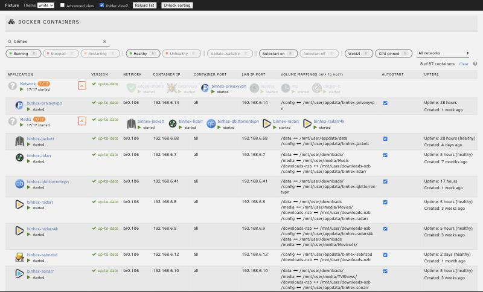
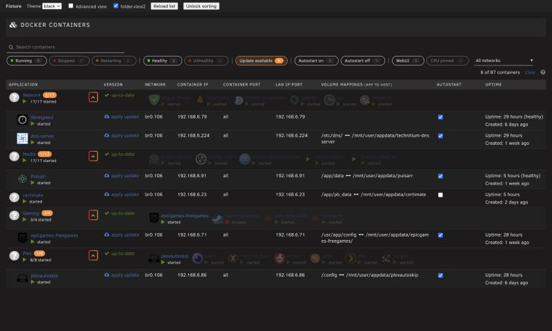

# Docker Search for Unraid

I've got 80-odd containers and got tired of scrolling the Docker tab to find one, so this
plugin adds a search box and some filter buttons to the top of the list.



Start typing and the list filters as you go: name, image, folder, network, IP or port all
work. You can get more specific with things like `image:linuxserver`, `net:br0`, `port:8080`
or `is:unhealthy`, and put a `-` in front to exclude (`-is:running`). Click the `?` next to
the search box for the full list.

The buttons filter by running/stopped, healthy/unhealthy, updates available, autostart,
WebUI and CPU pinning, and each one shows how many containers it would match. Press `/` to
jump to the search box and `Esc` to clear it. It remembers your last filter, and the URL
updates as you go, so you can bookmark something like `/Docker#f=update`.

If you use folder.view2, folders with a match open up automatically and close again when you
clear the search.



## Install

Plugins → Install Plugin, and paste:

```
https://raw.githubusercontent.com/davidcoulson/unraid-docker-search/main/docker.search.plg
```

Needs Unraid 7.0 or later. It doesn't touch any stock files, and uninstalling removes it
completely.

## Good to know

- Health filters rely on the container having a health check.
- "Update available" is only as fresh as your last "Check for Updates".
- Drag-to-reorder still works, but clear the filter first if you care exactly where things land.

## How this was made

I built this with an AI coding assistant (Claude). I decided what it should do, steered the
design, and tested it on my own server. A second AI (Codex) reviewed the code before release,
and I fixed what it found.

Want to hack on it? See [DEVELOPMENT.md](DEVELOPMENT.md). Bugs and ideas welcome in
[issues](https://github.com/davidcoulson/unraid-docker-search/issues).

MIT licensed.
