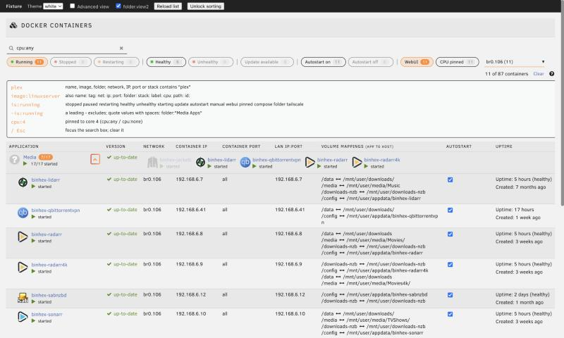

# Docker Search for Unraid

An Unraid plugin that puts a search box and quick filters at the top of the Docker
containers list. Useful once you have more containers than fit on a screen.


- **Search as you type** across name, image, folder, network, IP, port and compose stack.
  Case-insensitive substring match; all words must match.
- **`key:value` terms**: `name:` `image:` `tag:` `net:` `ip:` `port:` `folder:` `stack:`
  `label:` `cpu:` `path:` `id:`, plus `is:`/`has:` (`running` `stopped` `paused` `restarting`
  `healthy` `unhealthy` `starting` `update` `autostart` `manual` `webui` `pinned` `compose`
  `folder` `tailscale`). A leading `-` excludes: `-is:running`. Quote values with spaces:
  `folder:"Media Apps"`.
- **Filter chips** with live counts: Running, Stopped, Healthy, Unhealthy, Update available,
  Autostart on/off, WebUI, CPU pinned (plus Paused, Restarting, Starting, Compose and Tailscale
  when any container is in that state), and a network picker. Chips in one group (Running /
  Stopped) widen the match; chips in different groups narrow it. Counts show what you would get
  by adding that chip.
- **folder.view2 aware**: a folder stays visible when any container in it matches, opens
  automatically to show the matches (and closes again when you clear the filter), shows a
  `matches/total` badge, and dims the non-matching icons in its preview. If you close a
  folder yourself while filtering, it stays closed.
- **Keys**: `/` focuses the search box, `Esc` clears it.
- **Remembers** the last filter (localStorage) and mirrors it in the URL hash, so
  `…/Docker#q=image:linuxserver&f=running` can be bookmarked or shared.
- Follows the webGUI theme (white, black, azure, gray).




It never edits the rows; non-matching rows get a class that hides them. Sorting,
drag-to-reorder, context menus, the autostart switches and the Basic/Advanced toggle
work as before.

## Install

Plugins → Install Plugin, paste:

```
https://raw.githubusercontent.com/davidcoulson/unraid-docker-search/main/docker.search.plg
```

Requires Unraid 7.0 or later. Uninstalling removes everything it added.

## How it works

`DockerSearch.page` is a `Menu="Buttons"` page, which the webGUI evaluates in the `<head>` of
every page; it only emits the CSS and JS when the current page is Docker. That keeps the Docker
tab's own page list (and so its tabbed/untabbed layout) unchanged.

`js/docker-search.js` reads the rows that `DockerContainers.php` renders: name, state icon,
status line (health), autostart switch, networks, IPs, ports, volumes, the WebUI argument of the
context menu, and the `docker[]` array the page fills in (update status). A `MutationObserver`
on `#docker_list` re-applies the filter whenever the list is redrawn or folder.view2 rebuilds its
folders.

Some things are not on the page: the full image name (the page shortens it to 24 characters and
only shows it in Advanced view), CPU pinning and labels. `include/data.php` returns those as JSON
(read-only, behind the webGUI login) and the search uses them once they arrive; without it the
search still works on what the page shows.

`js/filter-core.js` holds all of the matching logic as a plain module with no DOM access.

## Develop

```
npm test                       # filter logic tests (node --test, no dependencies)
scripts/fetch-vendor.sh root@tower   # optional: webGUI CSS/fonts/icons into fixture/vendor (gitignored)
npm run serve                  # fixture page on http://localhost:8817/
scripts/build.sh 2026.10.12    # archive/docker.search-<version>.txz + version/MD5 in the .plg
```

`fixture/` is a capture of a real Docker page (83 containers, 8 folders), scrubbed by
`scripts/make-fixture.py`: host paths under `/mnt` rewritten (non-generic pools, shares and
folders become `poolN`/`shareN`/`dirN`, also where container paths mirror them), addresses
mapped to private test ranges, MACs and e-mail addresses replaced, labels cut to an allowlist,
private names replaced from a renames file kept outside the repo, and whole folders or
containers left out with `--drop-folder` / `--drop`. Check the output before committing it. `fixture/fv2-stub.js` stands in for folder.view2 (same DOM shape and
events), so folders can be tried without the real plugin; the fixture toolbar switches theme,
Basic/Advanced view, folders and sorting, and can redraw the list.

To refresh the fixture from your own server:

```
scripts/capture.sh root@tower /tmp/capture
python3 -I scripts/make-fixture.py /tmp/capture --renames ~/renames.json --drop-folder Private
```

## Limits

- Health comes from the status text Docker reports (`(healthy)`, `(unhealthy)`,
  `(health: starting)`); containers without a health check match none of the health chips.
  On a translated webGUI the page's text may differ, so the plugin falls back to the status
  from `data.php`.
- "Update available" uses the page's own update check, so it is only as fresh as the last
  "Check for Updates".
- Dragging rows to reorder while a filter is on moves them relative to the visible rows only;
  clear the filter first if the exact position matters.
- folder.view2 support relies on its markup and its `folderEvents`/`dropDownButton` globals;
  without folder.view2 the plugin works on the plain list.

## How this was made

Written with an AI coding assistant (Claude), human-guided throughout: I set the requirements
and design, reviewed the code (with a second, independent AI review by Codex), and tested it on
my own server (Unraid 7.4, 80+ containers, folder.view2) before release.

## Licence

MIT. The fixture's optional vendor files are fetched from your own server and are not part of
this repository.
